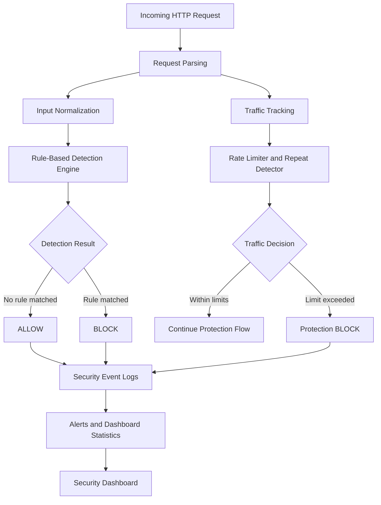

# SentinelShield Architecture

## Architecture Explanation

1. **Request parsing:** Collects HTTP request details.
2. **Input normalization:** Decodes input before detection.
3. **Detection engine:** Checks configured rules for SQL injection, XSS, path traversal, LFI and command injection.
4. **Traffic protection:** Checks rate limits and repeated requests.
5. **Decision:** Allows or blocks requests according to the protection logic.
6. **Logging and alerts:** Records security events for analysis.
7. **Dashboard:** Displays available security statistics.

*Note: Verify the exact runtime flow against the source code before final submission.*
